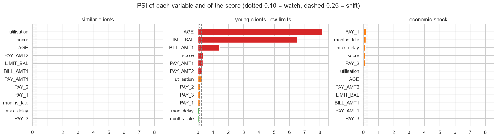

# Credit risk model as a service: FastAPI, MLflow, drift monitoring and Docker

The probability of default model of my credit scoring project, taken to production: training tracked in MLflow, a REST API with input validation, a drift report for every batch of clients, tests, a Docker image and CI on GitHub Actions that builds the image and calls it.

## Structure

| File | What it does |
|---|---|
| `creditapi/features.py` | the feature engineering, shared by training and API (no training/serving skew) |
| `creditapi/train.py` | trains a gradient boosting, logs parameters and metrics in MLflow (SQLite), saves the model, a model card and the reference distribution of each feature |
| `creditapi/app.py` | FastAPI: `/health`, `/model-info`, `/predict`, `/predict-batch` (with drift report from 100 clients) |
| `creditapi/monitoring.py` | PSI of each feature and of the score against the training data |
| `tests/test_api.py` | 7 tests: probabilities between 0 and 1, a late client gets a higher PD, invalid inputs are rejected (422), drift report, PSI |
| `Dockerfile`, `.github/workflows/ci.yml` | image with only the API dependencies; CI trains, tests, builds the image and makes a smoke test of the container |
| `monitoring_demo.ipynb` | three batches of new clients and their drift reports |

## Model
Gradient boosting on 11 features of the UCI credit card data: AUC 0.776, Gini 0.55, Brier 0.136 on the test set.

## Monitoring demo

| Batch | Mean PD | PSI of the score | Variables in "shift" (PSI > 0.25) |
|---|---|---|---|
| Clients similar to training | 22.1% | 0.005 | 0 |
| Campaign of young clients with low limits | 28.4% | 0.330 | 6 |
| Economic shock (more late payments) | 28.6% | 0.107 | 0 (5 in "watch") |

The first version of the PSI assumed 10% of the data in each training decile. With discrete variables (months late) many deciles are equal, and it gave false alarms on stable data; now the reference stores the real share of each bin, with a test for that case.



## How to run

```
pip install -r requirements.txt
python -m creditapi.train          # downloads the data and trains
pytest -q
uvicorn creditapi.app:app          # API on http://localhost:8000/docs
docker build -t credit-pd-api .    # optional
```

---
Alejandro Lezcano Osorio | Rennes School of Business (MSc in Financial Data Intelligence) and Universidad EIA
